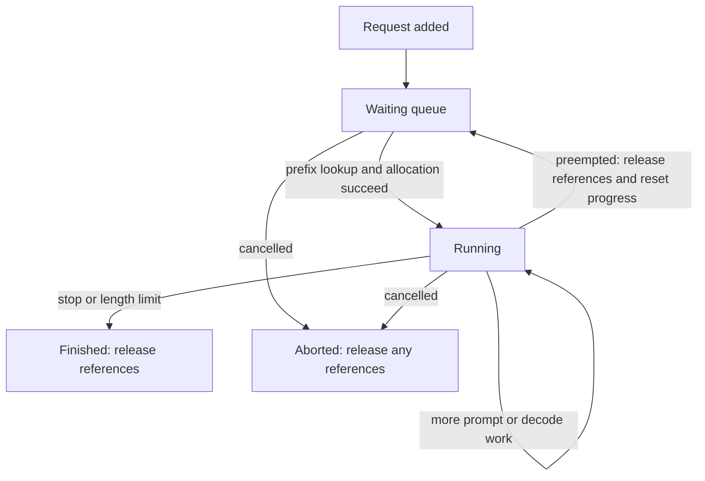

# Architecture and request lifecycle

[Guide index](README.md) · [Foundations](foundations.md) · [KV cache manager](kv-cache-manager.md) · [Source index](api-index.md)

This overview follows the implementation at [`62bfced`](https://github.com/sudhirpol522/small-vLLM/commit/62bfcedf01abcaa3df3d1905fd6028558e35dead). It explains the component relationships; detailed method walkthroughs will be added in the order shown in the guide index.

## Entering the engine

An offline caller uses [`Engine.generate`](https://github.com/sudhirpol522/small-vLLM/blob/62bfcedf01abcaa3df3d1905fd6028558e35dead/serve.py#L1786), which adds requests and repeatedly steps the engine until they finish.

An HTTP caller reaches [`build_app`](https://github.com/sudhirpol522/small-vLLM/blob/62bfcedf01abcaa3df3d1905fd6028558e35dead/serve.py#L1909). [`AsyncEngine`](https://github.com/sudhirpol522/small-vLLM/blob/62bfcedf01abcaa3df3d1905fd6028558e35dead/serve.py#L1798) puts additions and cancellations into a thread-safe inbox and drives the synchronous engine on a background thread. It routes outputs back to the request's asynchronous queue.

Both paths eventually reach [`Engine.add_request`](https://github.com/sudhirpol522/small-vLLM/blob/62bfcedf01abcaa3df3d1905fd6028558e35dead/serve.py#L1693), which creates a `Request`, adds it to the scheduler, and creates its detokenizer.

## The main components

| Component | State or work it owns | Main connections |
| --- | --- | --- |
| `Request` | Token IDs, processing progress, block IDs, sampling parameters, and completion metadata. | Scheduler, KV manager, and engine. |
| `Scheduler` | Waiting/running queues and the per-step token plan. | Uses the KV manager; returns `ScheduledRequest` objects. |
| `KVCacheManager` | Reference counts, prefix hashes, lookup entries, and the ordered free list. | Assigns and releases physical block IDs. |
| `ModelRunner` | GPU buffers, KV tensors, packed inputs, and captured decode graphs. | Executes the model and samples from logits. |
| `Model` and attention layers | Transformer computations and KV reads/writes. | Use runner-prepared metadata and the selected attention backend. |
| `Engine` | Request coordination, accepting sampled tokens, stop conditions, and output construction. | Calls scheduler, runner, and detokenizers. |
| `AsyncEngine` and `build_app` | HTTP-facing request flow and output streaming. | Bridge web requests to the synchronous engine. |

The manager's block IDs refer to storage allocated by the runner. Keeping these responsibilities separate is central to understanding the implementation: changing ownership metadata does not itself perform model computation.

## One engine step

[`Engine.step`](https://github.com/sudhirpol522/small-vLLM/blob/62bfcedf01abcaa3df3d1905fd6028558e35dead/serve.py#L1728) first calls `Scheduler.schedule()`. The scheduler considers running requests before waiting requests and shares one token budget between prefill work and decode work.

The scheduler uses `KVCacheManager.allocate()` to check capacity and prepare block ownership. Waiting requests first look for reusable prefix blocks. If a running request cannot extend, the scheduler can preempt requests from the newest end of the running list.

The resulting batch goes to `ModelRunner.run()`. The runner prepares packed token positions and KV metadata, executes the model, selects each request's last query row for logits, and returns sampled tokens plus logits. Eligible batches with one query token per request can use a captured CUDA graph; other batches use the eager path.

The engine then accepts samples only for requests whose scheduled work reaches the end of their current token sequence. Intermediate prefill chunks write KV data but do not append their sampled token to the request's output. For accepted tokens, the engine checks stop conditions and uses `Detokenizer.update()` to produce text deltas.

## Request ownership and lifecycle

During preemption, the scheduler clears the victim's block ownership through `free_request`, resets `num_computed_tokens` to zero, and places the request at the front of the waiting queue. The token IDs remain available for later resumption. Matching KV blocks may survive in the prefix cache, but the request must look them up and claim them again.

On completion or cancellation, `Scheduler.finish()` removes the request from its queue and releases its references. An unused block can retain its cached contents until allocation reassigns its storage.

## Where quantization fits

Quantization changes the projection-weight representation and execution path. `build_projection` selects a linear method, `load_model` loads checkpoint tensors, and the `quantization` package handles policy, GPTQ/AWQ layouts, and Marlin execution integration. These pieces will have their own chapter; the scheduling and block-ownership concepts remain the same.

## Next

Read [foundations](foundations.md) for the reuse and batching concepts, then the [KV cache manager walkthrough](kv-cache-manager.md) for concrete block-level examples. The [source index](api-index.md) provides exact definition locations for the remaining components.
