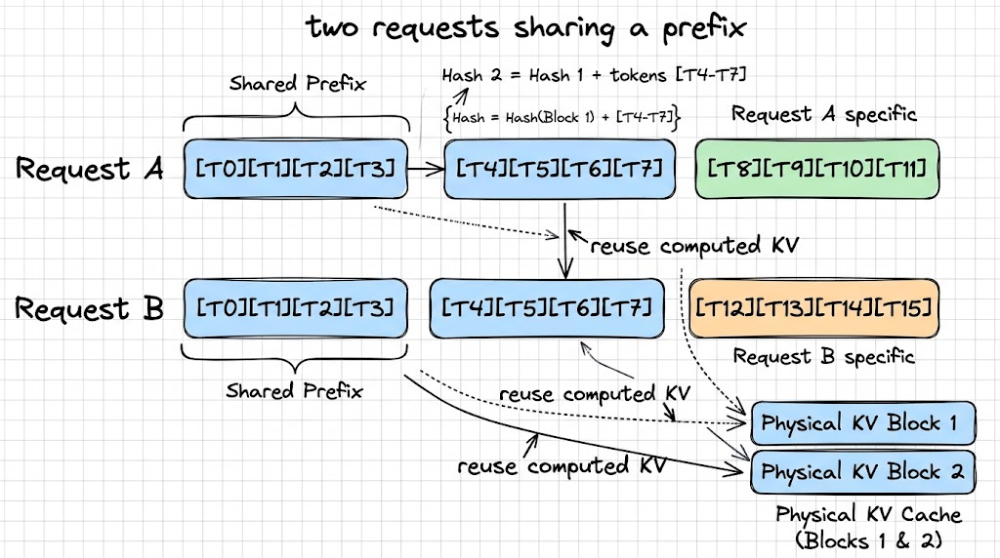
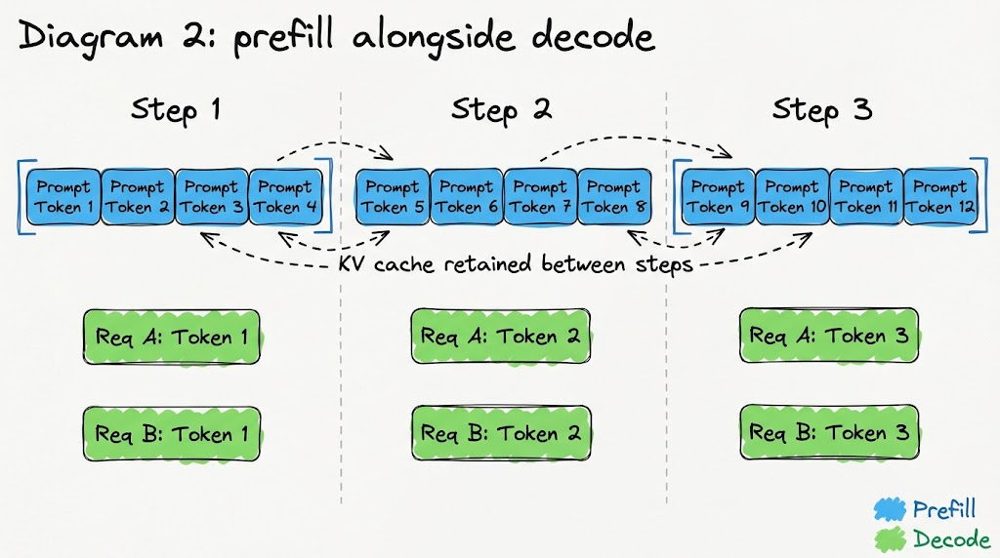

# Foundations: prefix caching and chunked prefill

[Guide index](README.md) · [Architecture](architecture.md) · [Source index](api-index.md)

This chapter assumes you know continuous batching. It introduces the concepts needed for the KV cache manager walkthrough.

## Start with the KV cache

An LLM processes a prompt and then generates output tokens. We can separate this into two phases:

- **Prefill:** process the prompt and calculate the keys and values used by attention.
- **Decode:** generate output tokens, typically one token per request per step, while adding their keys and values to the cache.

The KV cache stores those keys and values so the model can reuse them in later steps. Without it, the model would need to calculate them again for earlier tokens as generation continues.

The cache takes up GPU memory and grows as a request processes more tokens. That is why the inference engine needs to manage it carefully.

In the design we are discussing, KV memory is divided into fixed-size **blocks**. Each block has room for the keys and values of a fixed number of tokens. A request keeps track of which physical blocks hold its cache.

For example, if a block holds four tokens, a request with ten cached tokens needs three blocks. The last block has two occupied token positions and room for two more.

## Prefix caching: reuse work from an earlier request

Different requests often start with the same tokens. They might share a system prompt, instructions, or the beginning of a document.

Suppose two requests have these token sequences:

```text
Request A: [T0, T1, T2, T3, T4, T5, T6, T7, T8, T9, T10, T11]
Request B: [T0, T1, T2, T3, T4, T5, T6, T7, T12, T13, T14, T15]
```

The first eight tokens are identical. If A has already computed their KV cache and those blocks are still available, B can reuse that work. B only needs to compute the uncached part of its prompt.

That is prefix caching: **reuse the KV cache for a matching beginning of a request**.

The match is based on token IDs, not whether two pieces of text have a similar meaning. Reuse also assumes the same model and compatible execution settings.

### Why the earlier prefix matters

Matching the tokens inside one block is not enough. In a causal language model, a token's keys and values depend on the tokens before it.

Consider these sequences:

```text
Request A: [p1, p2, p3, p4] [x1, x2, x3, x4]
Request B: [q1, q2, q3, q4] [x1, x2, x3, x4]
```

The second block contains the same token IDs, but its earlier context is different. We cannot assume its KV cache is interchangeable.

To capture that context, we can build a block's hash from both the previous block's hash and the current block's token IDs:

```text
block_hash = hash(previous_block_hash, current_block_token_ids)
```

The first block uses an agreed starting value in place of a previous block hash. Each later hash carries information about the prefix leading up to that block.

This is the simplified key for the design discussed here. A system serving different models, adapters, or other relevant inputs must also distinguish those contexts. A hash is a practical identifier; it is not a mathematical guarantee that collisions are impossible.

The manager can then maintain a mapping from a prefix hash to a physical block containing the corresponding KV data.

### What a cache hit saves

A request looks for the longest available matching prefix. In the block-based approach described here, complete blocks are the unit of reusable prefix caching. A partially filled final block needs separate handling, which we will explain from the code.

A cache hit lets the request skip the model computation for the reused tokens. The manager still needs to identify the prefix, which may involve computing hashes and looking them up.

**The main saving is the KV computation, not avoiding hash computation.** A matching hash is useful only while the corresponding KV data is still valid in its physical block.

### Diagram 1: two requests sharing a prefix



Both requests share the first eight tokens, T0–T7. Their first logical blocks, T0–T3, use physical KV block 1; their second logical blocks, T4–T7, use physical KV block 2. The remaining tokens differ and need their own KV computation.

The second block's hash combines the first block's hash with its own tokens: `H2 = hash((H1, (T4, T5, T6, T7)))`. The hash identifies the earlier context as well as the current token block.


## Chunked prefill: process a long prompt over several steps

Prefix caching reduces repeated work. Chunked prefill controls how much prompt work happens in one scheduling step.

A long uncached prompt can take substantial computation to process. If the engine processes the entire prompt in one step, requests that are already decoding may wait longer for their next token.

With chunked prefill, the scheduler processes only part of the prompt in a step. It keeps the resulting KV cache and continues with the remaining tokens in later steps.

For example, a twelve-token prompt could be processed as follows:

| Scheduling step | Prompt tokens processed | Prompt progress |
| --- | --- | --- |
| 1 | Tokens 1–4 | 4 of 12 |
| 2 | Tokens 5–8 | 8 of 12 |
| 3 | Tokens 9–12 | 12 of 12 |

These chunks belong to the same request. When the model processes tokens 5–8, it uses the KV cache already computed for tokens 1–4.

The scheduler can also mix prefill work with decode work. For a simple example, suppose a step has a budget of six new token positions to process. Two decoding requests each need one token position. The remaining four positions can go to a prefill chunk. The exact priority and budget rules depend on the scheduler implementation.

A **chunk** is a scheduling choice. A **block** is a memory allocation unit. They do not have to be the same size; implementations may impose alignment rules.

### How prefix caching and chunked prefill work together

Suppose a request has twelve prompt tokens and finds a reusable prefix covering the first eight. It only needs prefill computation for the remaining four tokens. The scheduler may process those four together or divide them across steps, depending on its budget and rules.

Prefix caching answers: **Which prompt tokens already have reusable KV data?**

Chunked prefill answers: **How many of the remaining prompt tokens should we process in this step?**

### Diagram 2: prefill alongside decode



Each step processes four prompt tokens in blue while requests A and B each take one decode step in green. The long prompt keeps its KV cache between chunks: the second chunk uses the cache for tokens 1–4, and the third uses the cache for tokens 1–8. The arrows show that retained context, not a second request sharing this prompt's cache.

Next: [KV cache manager walkthrough](kv-cache-manager.md).
