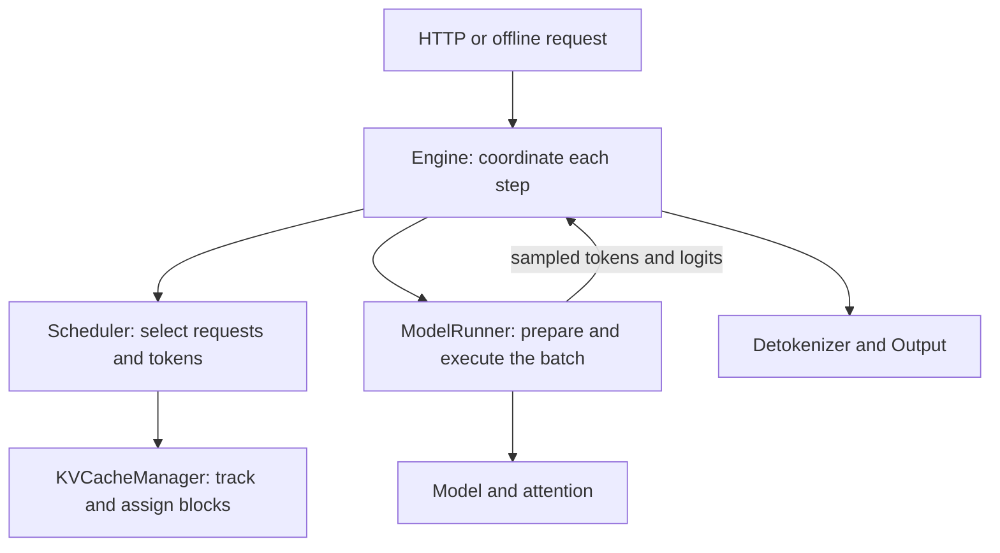

# small-vLLM

A compact, vLLM-style inference engine for learning how LLM serving works. The implementation brings together paged KV storage, prefix caching, continuous batching, chunked prefill, model execution, and an OpenAI-compatible HTTP interface.

Most of the engine lives in [`serve.py`](../serve.py). The source also uses the name **TinyServe**. The documentation follows a request through the engine, then explains each component with code, worked examples, and state changes.

## Architecture



`Engine.step()` asks the scheduler for a batch, sends it to the runner, and handles the results. The KV cache manager tracks block ownership and prefix identities. The runner allocates the GPU tensors that hold the actual KV data.

For HTTP requests, `build_app` and `AsyncEngine` connect the server to the engine. The offline entry point is `Engine.generate`.

## Start reading

| Reader's question | Start here |
| --- | --- |
| What happens to a request? | [Architecture and request lifecycle](architecture.md) |
| What are prefix caching and chunked prefill? | [Foundations](foundations.md) |
| How are KV blocks reused, allocated, and released? | [KV cache manager walkthrough](kv-cache-manager.md) |
| What should I read next? | [Reading order and chapter roadmap](README.md) |
| Where is a particular class or function? | [Source and documentation index](api-index.md) |

## Source map

| Location | Responsibility |
| --- | --- |
| [`serve.py`](../serve.py) | Request state, scheduling, KV bookkeeping, attention, model execution, sampling, engine, HTTP server, demos, and benchmarks. |
| [`quantization/`](../quantization/) | Quantization policy, linear-layer interface, GPTQ/AWQ weight handling, and Marlin execution integration. |
| [`inference.py`](../inference.py) | Example streaming client for the HTTP server. |
| [`integrate_serve_quantization.py`](../integrate_serve_quantization.py) | Source-transformation utility used to integrate quantization. |
| [`serve.py.before_quantization`](../serve.py.before_quantization) | Historical implementation before quantization integration. |

## Entry points

With the Python dependencies installed, the bookkeeping demo runs without loading a model or allocating GPU KV tensors:

```bash
python serve.py kv-demo
```

Model inference requires a compatible CUDA environment and model access. To start the server and use the existing client:

```bash
python serve.py serve --model Qwen/Qwen3-8B --port 8000
```

In another terminal:

```bash
python inference.py
```

These commands follow the current CLI. A versioned dependency specification and reproducible installation guide are still to be documented; GPU execution was not validated while preparing this documentation.

## Documentation status

The architecture overview, foundations, and KV cache manager walkthrough are available as drafts. The [index](api-index.md) distinguishes existing explanations from planned coverage for the remaining classes and functions. Some supplied diagrams still need the corrections listed in the [review notes](review-notes.md).

Source inspected: [`62bfced`](https://github.com/sudhirpol522/small-vLLM/commit/62bfcedf01abcaa3df3d1905fd6028558e35dead). Source links in the detailed documentation are pinned to that revision.
